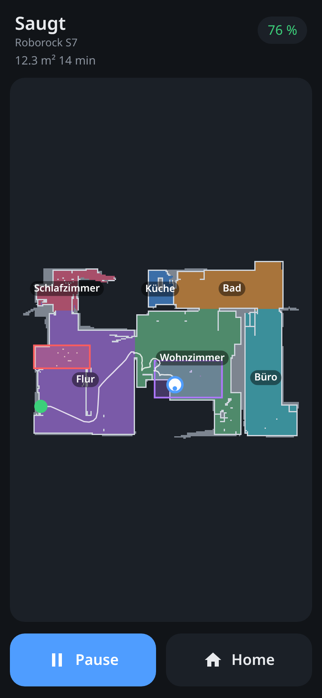

# Roscoe

[](https://github.com/michaelkrisper/saugi/actions/workflows/deploy.yml)
[](https://github.com/michaelkrisper/saugi/releases)
[](LICENSE)
[](https://biomejs.dev)
[](https://roscoe.krisperapps.de)
[](https://roscoe.krisperapps.de)

A fast, minimal remote for Roborock robot vacuums, built as a PWA. One single
page instead of the official app: start, pause, send it home, plus a live map
with position, path and restricted zones.

**→ [roscoe.krisperapps.de](https://roscoe.krisperapps.de)**

<p align="center">
  
</p>

## Features

- **Start / pause / resume** and **go home**, nothing else. A paused room or
  zone clean is resumed instead of starting a full clean.
- **Live map** with room names, the path of the current run, the robot with
  its heading, and the dock. Refreshed every 3 seconds while it is moving.
- **No-go zones** (red), **no-mop zones** (purple) and **virtual walls**.
- **Status**: state, battery, cleaned area and duration.
- **Opens instantly**: the app shell is served offline by the service worker,
  the last map and status come from the cache, live data follows.
- Feels native: no zoom, no scrolling, safe-area aware, dark mode.
- English user interface.

## Sign-in

The app is private: a code word, set on the server, opens it. Behind it you sign
in once with your Roborock account and an e-mail code, just like the official
app. The server keeps the IoT credentials and talks to the vacuum; a browser
never gets them. When the sign-in expires the app asks again.

Install: on iOS via Safari → Share → "Add to Home Screen", on Android via
Chrome → "Install app".

Supported are vacuums speaking Roborock protocol `1.0` (e.g. the S series);
devices using the newer `A01`, `B01` or `L01` protocols are skipped at sign-in.
Developed and tested with an S7 (`roborock.vacuum.a15`).

## How it works

A small Node service (`server/`) speaks the Roborock protocol and offers the app
in the browser a plain JSON API (`/api`, `public/js/remote.js`). The protocol
modules are browser-compatible ES modules and live in `public/js/`:

| Module | Purpose |
| --- | --- |
| `public/js/api.js` | E-mail code login, device list (Hawk-signed REST calls) |
| `public/js/mqtt.js` | Minimal MQTT 3.1.1 client |
| `public/js/protocol.js` | `1.0` message framing, AES-ECB with timestamp-derived keys, map responses |
| `public/js/crypto.js` | MD5, CRC32, AES-ECB on top of WebCrypto |
| `public/js/map.js` | Parse the map format (image, path, robot, zones) and rasterise it (browser) |
| `public/js/app.js` | UI, commands (browser) |
| `server/feed.js` | Status and map pushed to the browsers (server-sent events) |
| `server/vacuums.js`, `server/api.js` | The stored sign-in, the connection to the vacuums, the `/api` routes |
| `server/access.js` | The code word |

No build step and no runtime dependencies. Node 26.

```sh
npm install
npm run dev      # static files + server on http://localhost:8792 (code word "dev")
npm run check    # Biome + tests
node scripts/browser-check.mjs http://localhost:8792   # headless Chrome smoke test
```

The tests run with Node's built-in test runner, no test dependencies:

| File | Covers |
| --- | --- |
| `tests/protocol.test.js` | MD5, CRC32, AES, the message format, the Hawk signature and the map parser, byte for byte against reference values from python-roborock |
| `tests/codec.test.js` | Codec edge cases: PKCS#7 padding at block boundaries, checksum and version rejection, frames without CRC, RPC envelope, HMAC (RFC 4231) |
| `tests/mqtt.test.js` | MQTT framing against a fake socket: CONNECT, SUBSCRIBE/SUBACK, PUBLISH/PUBACK, packet-id wrap, fragmented frames and multi-byte lengths |
| `tests/relay.test.js` | The REST function and the host allowlists: allowed hosts, forwarded headers, path and query mapping |
| `tests/node.test.js` | The server entry over real HTTP: start page, nothing besides the api, origin, body size and per-client limits |
| `tests/access.test.js` | The code word and the `/api`: locked without the cookie, guess limit, the sign-in stays on the server, RPC allowlist |

The browser smoke test hands the server deliberately wrong credentials, so it
never drives a real vacuum; it needs a freshly started `npm run dev`.

Every push and pull request goes through lint and tests; pushes to `main` are
then deployed to the own server (Caddy for the static files, a Node service
for the api; see [docs/SERVER.md](docs/SERVER.md)). Every
merge to `main` is tagged with the next patch version and only tagged commits
are deployed; bundled releases with release notes come from the Release
workflow (see [CONTRIBUTING](CONTRIBUTING.md#versions-and-releases)).

## Contributing

Issues and pull requests are welcome; see [CONTRIBUTING.md](CONTRIBUTING.md).

## Acknowledgements

The protocol and map format are ports of
[python-roborock](https://github.com/Python-roborock/python-roborock) and
[vacuum-map-parser-roborock](https://github.com/PiotrMachowski/Python-package-vacuum-map-parser-roborock)
(both Apache-2.0). The test maps in `tests/fixtures/*.bin` come from
python-roborock's test data.

Not an official Roborock product.

## License

[MIT](LICENSE)
