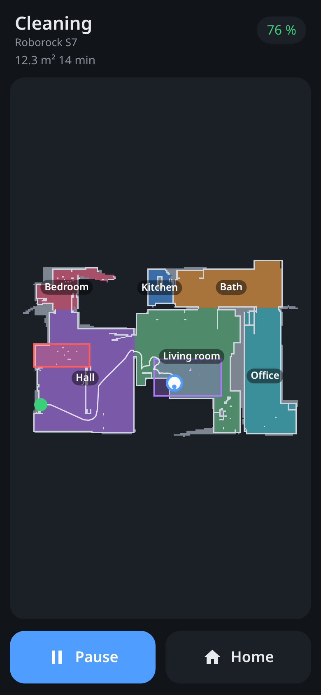

# Roscoe

[](https://github.com/michaelkrisper/saugi/actions/workflows/deploy.yml)
[](LICENSE)
[](https://biomejs.dev)
[](https://saugi.pages.dev)

A fast, minimal remote for Roborock robot vacuums, built as a PWA. One single
page instead of the official app: start, pause, send it home, plus a live map
with position, path and restricted zones.

**→ [saugi.pages.dev](https://saugi.pages.dev)**

<p align="center">
  
</p>

## Features

- **Start / pause / resume** and **go home**, nothing else. A paused room or
  zone clean is resumed instead of starting a full clean.
- **Live map** with room names, the path of the current run, the robot with
  its heading, and the dock. Refreshed every 3 seconds while it is moving.
- **No-go zones** (red), **no-mop zones** (purple) and **virtual walls**.
- **Status**: state, battery, cleaned area and duration.
- **Opens instantly**: the app shell is served offline by the service worker,
  the last map and status come from the cache, live data follows.
- Feels native: no zoom, no scrolling, safe-area aware, dark mode.

## Sign-in

With your Roborock account and an e-mail code, just like the official app. Only
the IoT credentials are stored, in the device's `localStorage`; there is no
server of our own that keeps any credentials.

Install: on iOS via Safari → Share → "Add to Home Screen", on Android via
Chrome → "Install app".

Supported are vacuums speaking Roborock protocol `1.0` (e.g. the S series);
devices using the newer `A01`, `B01` or `L01` protocols are skipped at sign-in.
Developed and tested with an S7 (`roborock.vacuum.a15`).

## How it works

The browser speaks the Roborock protocol itself:

| Module | Purpose |
| --- | --- |
| `public/js/api.js` | E-mail code login, device list (Hawk-signed REST calls) |
| `public/js/mqtt.js` | Minimal MQTT 3.1.1 client over WebSocket |
| `public/js/protocol.js` | `1.0` message framing, AES-ECB with timestamp-derived keys, map responses |
| `public/js/crypto.js` | MD5, CRC32, AES-ECB on top of WebCrypto |
| `public/js/map.js` | Parse the map format (image, path, robot, zones) and rasterise it |
| `public/js/app.js` | UI, polling, commands |

It still can't run entirely without a server: the Roborock API sends no CORS
headers, and the MQTT broker only listens on raw TLS (port 8883), which a
browser cannot open. Two stateless Cloudflare Pages Functions therefore just
pass bytes through, and only to `*.roborock.com`:

- `functions/rest/[[path]].js`: `/rest/<host>/<path>` → `https://<host>/<path>`
- `functions/mqtt.js`: WebSocket ↔ TLS socket to the broker

Device commands stay AES-encrypted with the device key along the way.

## Development

No build step, no runtime dependencies. Node ≥ 24.

```sh
npm install
npm run dev      # wrangler pages dev on http://localhost:8792
npm run check    # Biome + tests
npm run deploy   # Cloudflare Pages (branch main)
node scripts/browser-check.mjs http://localhost:8792   # headless Chrome smoke test
```

The tests (`tests/protocol.test.js`) compare MD5, CRC32, AES, the message
format, the Hawk signature and the map parser byte for byte against reference
values from python-roborock. The smoke test signs in with deliberately wrong
credentials, so it never drives a real vacuum.

Every push to `main` goes through lint and tests and is then deployed, as long
as the `CLOUDFLARE_API_TOKEN` secret is set.

## Acknowledgements

The protocol and map format are ports of
[python-roborock](https://github.com/Python-roborock/python-roborock) and
[vacuum-map-parser-roborock](https://github.com/PiotrMachowski/Python-package-vacuum-map-parser-roborock)
(both Apache-2.0). The test maps in `tests/fixtures/*.bin` come from
python-roborock's test data.

Not an official Roborock product.

## License

[MIT](LICENSE)
